Accepted at the **Tackling Climate Change with Machine Learning workshop at NeurIPS 2026**.

The code learns relationships between engine measurements to identify faulty sensors and estimate replacement readings. It also evaluates selected fuel corrections in combustion emissions accounting.

## Install

Use Python 3.11 or 3.12. Run these commands from the repository root.

```bash
python3 -m venv .venv
source .venv/bin/activate
python -m pip install -r requirements.txt
```

## Data

[data/engine_map.csv](data/engine_map.csv) contains the 217 healthy steady-state operating points used in the diesel experiments. Each row contains the following eight measured quantities. [data/data_dictionary.csv](data/data_dictionary.csv) gives their meanings, units, and roles, along with the two additional columns `point_id` and `rpm_level`.

| Column | Measurement | Unit |
| --- | --- | --- |
| `Engine Speed` | Engine speed | rpm |
| `Torque` | Engine torque | N m |
| `T_IM` | Intake manifold temperature | °C |
| `P_IM` | Intake manifold pressure | bar |
| `EGR_Rate` | Exhaust gas recirculation rate | % |
| `MF_IA` | Intake air mass flow | kg/h |
| `NOx_EO` | Engine-out nitrogen oxide concentration | ppm |
| `MF_FUEL` | Fuel mass flow | kg/h |

The healthy measurements provide both model inputs and prediction targets. Each model predicts a sensor from engine speed, torque, and the other readings specified by its experiment. The scripts generate synthetic faults, fault labels, predictions, and result tables from these reference measurements.

`point_id` labels each operating point; `rpm_level` is rounded engine speed used to form the test splits. The dataset has 21 speed levels. The full settings use seven outer splits and four development splits.

The two CSV files are supplied under [CC BY 4.0](data/LICENSE.md). To use another compatible dataset, pass its repository-relative filename with `--data-path`.

## Run

Start with reduced settings.

```bash
python run_experiments.py --quick --data-path data/engine_map.csv --output outputs/quick
```

Run both experiment suites with the full settings and three seeds.

```bash
python run_experiments.py --full --data-path data/engine_map.csv --seeds 42 123 2026 --variants candidate adjusted covariance pca autoencoder --primary-tasks baseline severity diversity stress --output outputs/full
```

Use `--suite primary` for sensor diagnosis or `--suite climate` for fuel correction and emissions accounting. Both run on CPU and write generated outputs to the chosen folder. Use `--help` to see the available options.

## Code

| Path | Purpose |
| --- | --- |
| `run_experiments.py` | Run the main experiment suites |
| `experiments/primary.py` | Sensor diagnosis and method comparisons |
| `experiments/climate.py` | Fuel correction and emissions accounting |
| `experiments/` | Additional component and turbofan studies |
| `src/` | Shared models, fault generation, and evaluation |
| `scripts/download_turbofan_data.py` | Download data for the optional turbofan study |
| `assets/pipeline.svg` | Animated overview of the experiment pipelines |
| `data/engine_map.csv` | Measured operating points for the diesel experiments |
| `data/data_dictionary.csv` | Measurement units and column roles |

Software is available under the [MIT license](LICENSE). The measurement data use the license described above.


